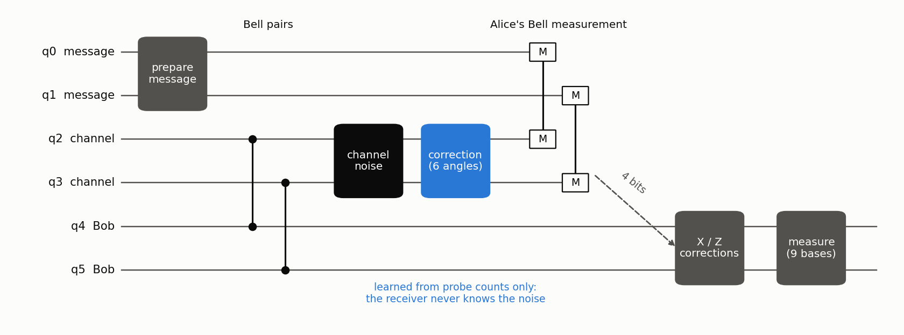
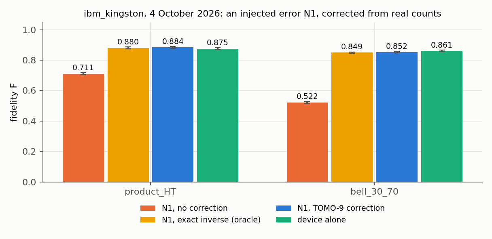

# Two-qubit teleportation through a noisy channel, corrected from measurement counts

[](https://github.com/amirab78/teleportation-counts-correction/actions/workflows/ci.yml)
[](LICENSE)

[](https://doi.org/[DOI])

Code, data and notebooks of the study *Two-qubit quantum teleportation through a noisy channel, repaired by a
counts-only parametric correction* (Amir H. Abdolhosseini, 2026).

A two-qubit message is teleported through a channel whose qubits are disturbed by unknown noise. A correction box,
one parametric gate per channel qubit, is learned **from measurement counts only**: the receiver never knows the noise
or the message. Coherent noise is removed completely. Incoherent noise sets a ceiling that the counts-only calibration
reaches. Crosstalk needs a two-qubit correction. Process tomography with nine circuits (TOMO-9) is the most
shot-efficient way to learn the correction. On a real IBM quantum computer, the correction learned from that device's
own counts recovered the whole injected error.



## The study in eight steps

Each step is one notebook in `notebooks/`, executed with its outputs saved. Each notebook asks one question, gives the
model, applies the method from the `telecorr` package, shows the result, and leads to the next step.

| step | notebook | question | result |
|---|---|---|---|
| 1 | [Teleportation](notebooks/01_teleportation.ipynb) | Why does the ideal protocol deliver every message? | Teleportation is the identity channel: F = 1 for every message. |
| 2 | [Channel noise](notebooks/02_channel_noise.ipynb) | What does noise on the channel qubits do, and where can it be undone? | The rotations N1 lower F to 0.790 / 0.607 (`product_HT` / `bell_30_70`). Only a correction on the channel qubits can restore F = 1. |
| 3 | [Correction from counts](notebooks/03_correction_from_counts.ipynb) | Can the correction be learned from counts alone? | Three probe states and COBYLA reach F = 0.999906 / 0.999874. |
| 4 | [Automatic recalibration](notebooks/04_automatic_recalibration.ipynb) | Can it repair itself when the channel drifts or jumps? | Worst message F 0.9919 over 13 random channels (single start: 0.9413); mean F 0.9955 on a drifting channel. |
| 5 | [Incoherent noise and the ceiling](notebooks/05_incoherent_noise_and_ceiling.ipynb) | What is the best possible F, and is it reached? | The ceiling is a Procrustes rotation; the calibrator reaches it within 9.3·10⁻⁶. |
| 6 | [Correlated noise](notebooks/06_correlated_noise.ipynb) | What does crosstalk change? | Local corrections stop at 0.8341 / 0.8291; a two-qubit correction reaches 0.9112 / 0.9073 (ceilings), learned by TOMO-75. |
| 7 | [Efficient learning and tracking](notebooks/07_efficient_learning_and_tracking.ipynb) | What is the most shot-efficient method, also under drift? | TOMO-9: gap ≈ 4.9 / shots. Under slow drift a Kalman tracker (ABC) needs 3.3× fewer shots. |
| 8 | [Real hardware](notebooks/08_real_hardware.ipynb) | Does it work on a real quantum computer? | Yes: see below. |

## On a real quantum computer

On 4 October 2026 the protocol ran on IBM's `ibm_kingston` (four jobs, 196 s of QPU time). The rotations N1 were
injected into the channel, and TOMO-9 learned the correction from the device's own counts. Every job and its predicted
outcome were fixed and hashed before the job was sent.



| message | F, no correction | F, learned correction | F, device alone | recovered fraction f (95 % Fieller interval) |
|---|---|---|---|---|
| `product_HT` | 0.711 | 0.884 | 0.875 | 1.057 [0.952, 1.177] |
| `bell_30_70` | 0.522 | 0.852 | 0.861 | 0.975 [0.934, 1.017] |

f = 1 lies inside both intervals: the correction recovered the whole injected loss, as well as the exact inverse of the
noise would. An error of the device itself (the channel qubits waiting 8 µs) was partly corrected as well, from
F = 0.562 to 0.809. Every hardware number is rebuilt from the raw counts in `data/`, without an account or a quantum
computer. The full record of the experiment is in [docs/hardware.md](docs/hardware.md).

## Installation

Python 3.11 or newer. The versions every result was produced with are pinned in `pyproject.toml`
(`requirements-lock.txt` lists the complete environment).

```bash
git clone https://github.com/amirab78/teleportation-counts-correction.git
```

```bash
cd teleportation-counts-correction
```

```bash
python -m pip install -e ".[test,notebooks]"
```

## Quick start

Learn the correction of the coherent channel noise N1 from counts, and compare the fidelity before and after:

```python
import numpy as np
from telecorr import calibrate, channels
from telecorr.states import message_state

T = channels.leg_T()                                          # the channel: rotations N1 (unknown to the calibrator)
sampler = calibrate.ProbeSampler(T, np.random.default_rng(1))  # runs the probe circuits, returns counts
x = calibrate.cobyla(np.zeros(6), sampler)                    # six correction angles, learned from counts only
msgs = [message_state("product_HT"), message_state("bell_30_70")]
print(calibrate.scores(None, T, msgs)["F"], "->", calibrate.scores(x, T, msgs)["F"])
```

## Reproducing the results

| what | command | time |
|---|---|---|
| every test: proven results and saved numbers | `pytest` | 1.5 min |
| every hardware number from the raw counts, compared with the saved results (4711 values) | `python -m telecorr.hardware reproduce --check` | 20 s |
| the eight notebooks (executed in place) | `python scripts/run_notebooks.py` | 3 min |
| the figures of this page | `python scripts/make_figures.py` | 20 s |

[docs/claims.md](docs/claims.md) maps every proven result (theorem, proposition) to its test.
[docs/methods.md](docs/methods.md) gives the notation, the methods step by step, and the limitations.
Exact results reproduce to the last digit. Calibrations that sample shot noise reproduce the study in distribution,
with the tolerance stated in each test.

## Repository layout

```
src/telecorr/          the package, one module per step (see its docstring)
  hardware/            the analysis of the IBM runs from the raw counts
notebooks/             01-08, the study step by step (executed)
tests/unit/            proven results as tests
tests/regression/      the saved numbers of the study reproduced
data/                  hardware counts, calibration record, frozen circuits, pre-registration, saved results
docs/                  methods and notation, claims -> tests, the hardware record, publishing guide
scripts/               figures, notebook runner, how data/ was made, the (disabled) hardware submission script
figures/               the figures of this page
```

## Data

`data/` (2.3 MB) holds the counts and per-shot outcomes of the four hardware jobs, the device calibration record in
force when they ran, the frozen circuits, the pre-registration record, and the saved results that the tests compare
with. Account and billing fields were removed; the counts are unchanged. See [data/README.md](data/README.md).

## Limitations

The hardware experiment ran on one device on one day. The device simulator built from IBM's calibration record was
too optimistic in absolute fidelity; the relative predictions held. The two-qubit correction and drift tracking were
not run on hardware. Steps 2–7 use model noise families. Details in [docs/methods.md](docs/methods.md#limitations).

## How to cite

If you use this code or data, please cite the archived release:

```bibtex
@software{telecorr_2026,
  author    = {Amir H. Abdolhosseini},
  title     = {Two-qubit teleportation through a noisy channel, corrected from measurement counts: code and data},
  year      = {2026},
  version   = {1.0.0},
  publisher = {Zenodo},
  doi       = {[DOI]},
  url       = {https://doi.org/[DOI]}
}
```

`CITATION.cff` holds the same metadata.

## Licence and acknowledgements

MIT licence (see `LICENSE`), for the code and the data.

The hardware experiment used IBM Quantum services.
